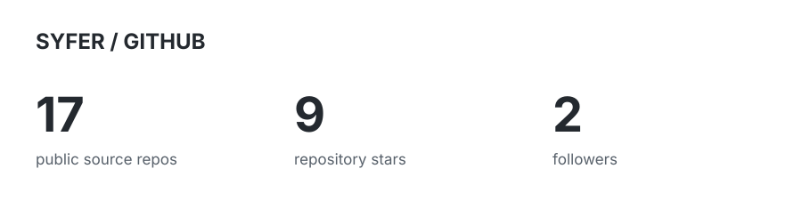
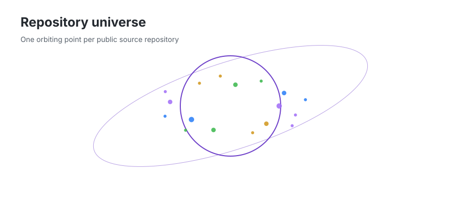
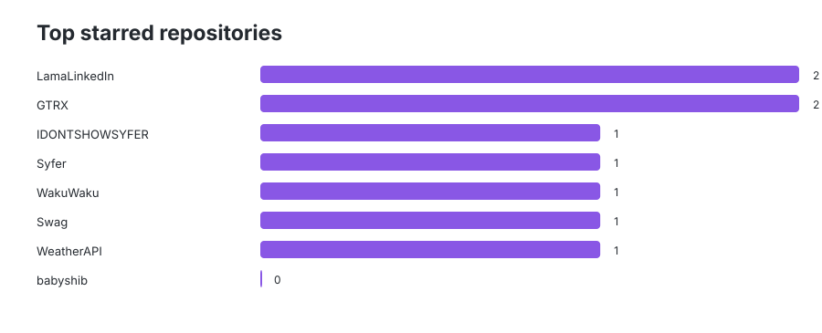
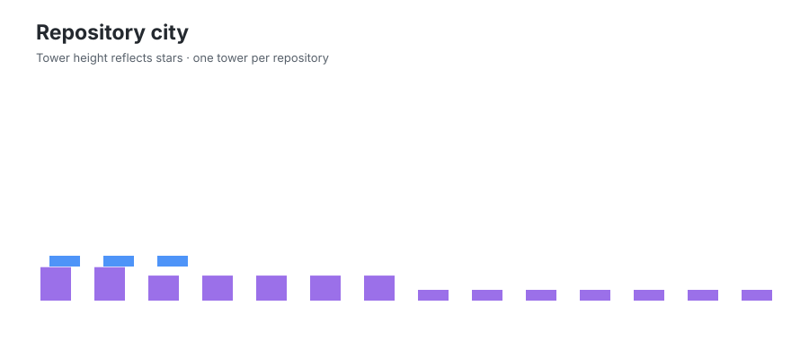
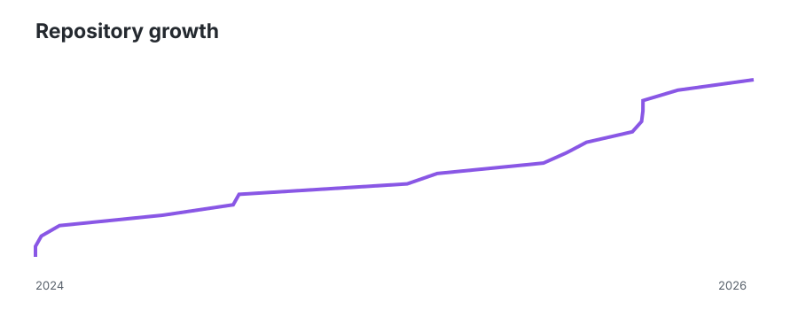
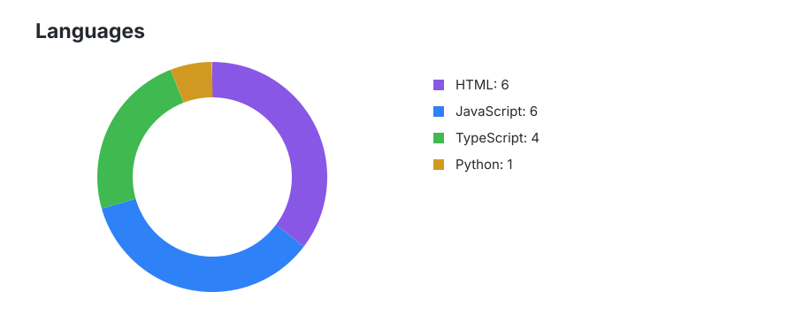
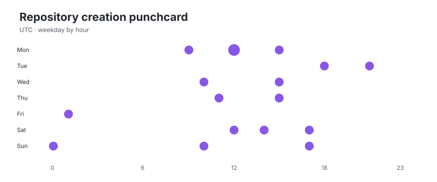

<h1 align="center">Syfer</h1>

  <b>Developer · Web Applications · AI · Crypto</b>
   
  Building and exploring software, from web applications to on-chain technologies.

  
  
  
  

  <picture>
    <source media="(prefers-color-scheme: dark)" srcset="./assets/stats-dark.svg"/>
    <source media="(prefers-color-scheme: light)" srcset="./assets/stats-light.svg"/>
    
  </picture>

  <picture>
    <source media="(prefers-color-scheme: dark)" srcset="./assets/planet-dark.svg"/>
    <source media="(prefers-color-scheme: light)" srcset="./assets/planet-light.svg"/>
    
  </picture>

## Start here

Explore my projects, experiments and open-source work.

<!-- START_PROJECTS -->
<!-- END_PROJECTS -->

<picture>
  <source media="(prefers-color-scheme: dark)" srcset="./assets/top-stars-dark.svg"/>
  <source media="(prefers-color-scheme: light)" srcset="./assets/top-stars-light.svg"/>
  
</picture>

## By the numbers

A visual overview of my public GitHub repositories, generated from GitHub data.

<picture>
  <source media="(prefers-color-scheme: dark)" srcset="./assets/city-dark.svg"/>
  <source media="(prefers-color-scheme: light)" srcset="./assets/city-light.svg"/>
  
</picture>

<picture>
  <source media="(prefers-color-scheme: dark)" srcset="./assets/growth-dark.svg"/>
  <source media="(prefers-color-scheme: light)" srcset="./assets/growth-light.svg"/>
  
</picture>

<picture>
  <source media="(prefers-color-scheme: dark)" srcset="./assets/languages-dark.svg"/>
  <source media="(prefers-color-scheme: light)" srcset="./assets/languages-light.svg"/>
  
</picture>

<picture>
  <source media="(prefers-color-scheme: dark)" srcset="./assets/punchcard-dark.svg"/>
  <source media="(prefers-color-scheme: light)" srcset="./assets/punchcard-light.svg"/>
  
</picture>

## Repositories

My public repositories, automatically listed and organized.

<!-- START_REPOSITORIES -->
<!-- END_REPOSITORIES -->

## Say hi

Interested in my work or want to collaborate?

  
  

  Built from real GitHub data · Updated automatically

