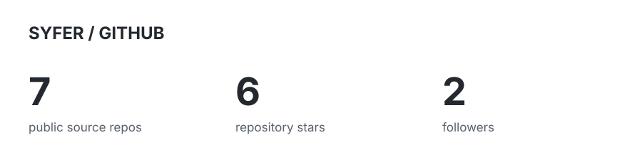
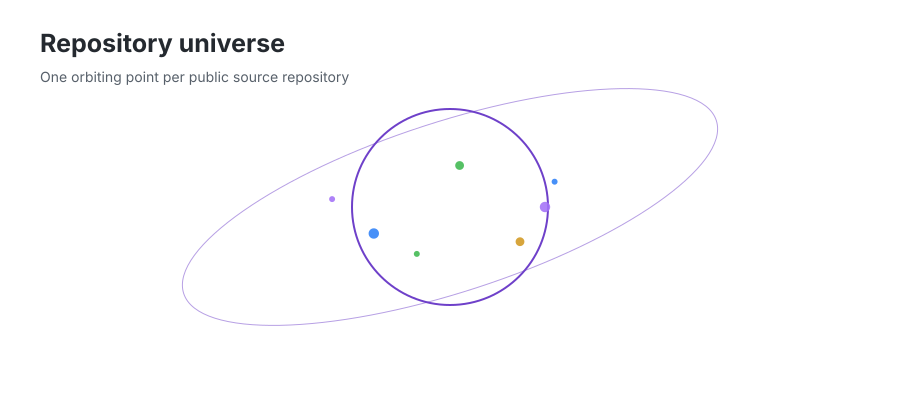
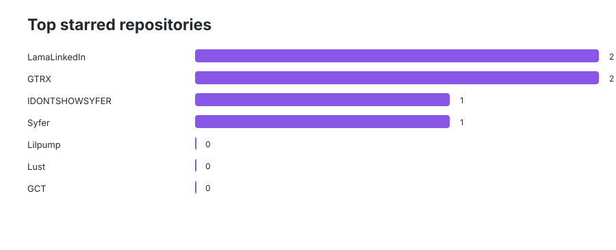
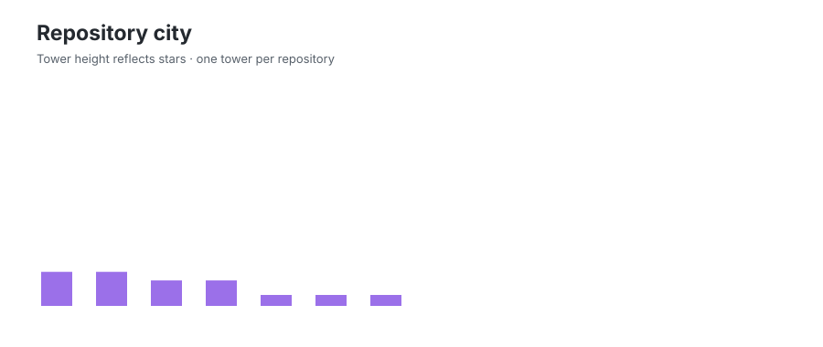
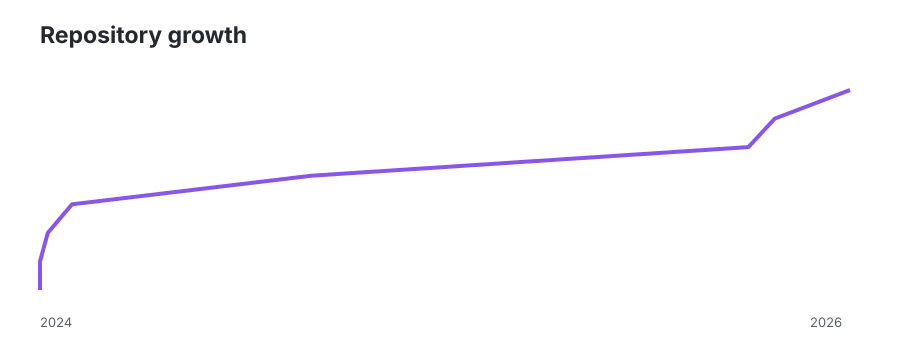
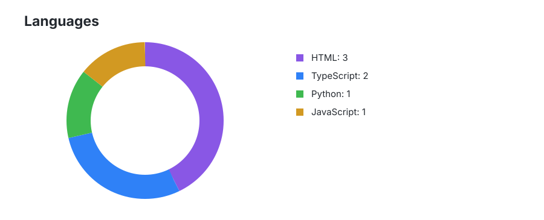
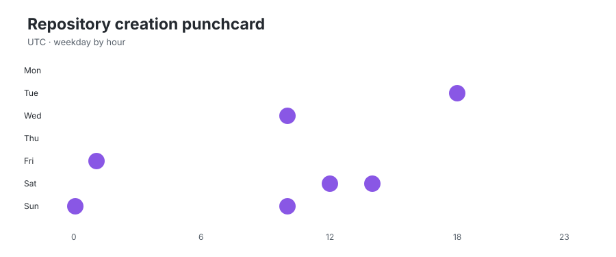

<h1 align="center">Syfer</h1>

<b>Developer · Web applications · Crypto &amp; creative technology</b>

  

<picture><source media="(prefers-color-scheme: dark)" srcset="./assets/stats-dark.svg"/><source media="(prefers-color-scheme: light)" srcset="./assets/stats-light.svg"/></picture>

<picture><source media="(prefers-color-scheme: dark)" srcset="./assets/planet-dark.svg"/><source media="(prefers-color-scheme: light)" srcset="./assets/planet-light.svg"/></picture>

## Start here

- [LamaLinkedIn](https://github.com/IDONTSHOWSYFER/LamaLinkedIn) ★2: Lama LinkedIn is a Chrome extension that boosts LinkedIn prospecting with a guided mode and an agent-assisted mode: like highlighting, smart comment/m

- [GTRX](https://github.com/IDONTSHOWSYFER/GTRX) ★2: Introducing $GTRX, the revolutionary MemeCoin on the Tron blockchain, launched on SunPump ! Join the movement, embrace the power of memes, and be part

- [IDONTSHOWSYFER](https://github.com/IDONTSHOWSYFER/IDONTSHOWSYFER) ★1: Source code and documentation

- [Syfer](https://github.com/IDONTSHOWSYFER/Syfer) ★1: Source code and documentation

- [Lilpump](https://github.com/IDONTSHOWSYFER/Lilpump) ★0: ESSKEETIT - Ultra-smooth, animated one-page site for Lil Pump’s $LILPUMP memecoin on Solana. Dark-rose &amp; dark-green rap aesthetic, scroll-triggered vi

- [Lust](https://github.com/IDONTSHOWSYFER/Lust) ★0: Lust is a professional website for photographer Esteban Luiz, offering an elegant interface to showcase galleries, manage portfolios, and allow client

<picture><source media="(prefers-color-scheme: dark)" srcset="./assets/top-stars-dark.svg"/><source media="(prefers-color-scheme: light)" srcset="./assets/top-stars-light.svg"/></picture>

## By the numbers

<picture><source media="(prefers-color-scheme: dark)" srcset="./assets/city-dark.svg"/><source media="(prefers-color-scheme: light)" srcset="./assets/city-light.svg"/></picture>

<picture><source media="(prefers-color-scheme: dark)" srcset="./assets/growth-dark.svg"/><source media="(prefers-color-scheme: light)" srcset="./assets/growth-light.svg"/></picture>

<picture><source media="(prefers-color-scheme: dark)" srcset="./assets/languages-dark.svg"/><source media="(prefers-color-scheme: light)" srcset="./assets/languages-light.svg"/></picture>

<picture><source media="(prefers-color-scheme: dark)" srcset="./assets/punchcard-dark.svg"/><source media="(prefers-color-scheme: light)" srcset="./assets/punchcard-light.svg"/></picture>

## All repositories

- [GCT](https://github.com/IDONTSHOWSYFER/GCT) ★0: Grumpycator is a fun platform to create, customize, and save your own grumpy cat. Use playful tools to design unique and quirky feline frien

- [GTRX](https://github.com/IDONTSHOWSYFER/GTRX) ★2: Introducing $GTRX, the revolutionary MemeCoin on the Tron blockchain, launched on SunPump ! Join the movement, embrace the power of memes, a

- [IDONTSHOWSYFER](https://github.com/IDONTSHOWSYFER/IDONTSHOWSYFER) ★1: 

- [LamaLinkedIn](https://github.com/IDONTSHOWSYFER/LamaLinkedIn) ★2: Lama LinkedIn is a Chrome extension that boosts LinkedIn prospecting with a guided mode and an agent-assisted mode: like highlighting, smart

- [Lilpump](https://github.com/IDONTSHOWSYFER/Lilpump) ★0: ESSKEETIT - Ultra-smooth, animated one-page site for Lil Pump’s $LILPUMP memecoin on Solana. Dark-rose &amp; dark-green rap aesthetic, scroll-tr

- [Lust](https://github.com/IDONTSHOWSYFER/Lust) ★0: Lust is a professional website for photographer Esteban Luiz, offering an elegant interface to showcase galleries, manage portfolios, and al

- [Syfer](https://github.com/IDONTSHOWSYFER/Syfer) ★1: 

## Say hi

Follow me on [GitHub](https://github.com/IDONTSHOWSYFER) or [X @0xSyfer](https://x.com/0xSyfer).

Auto-generated from GitHub public repositories · 7 repositories · 6 stars.

